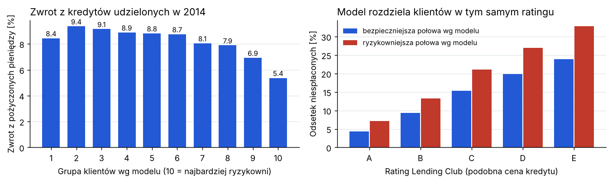
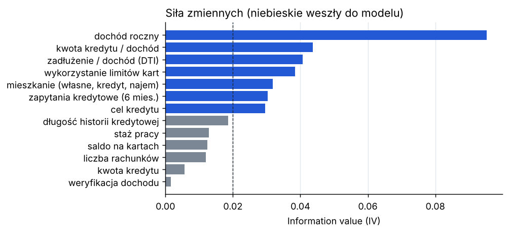
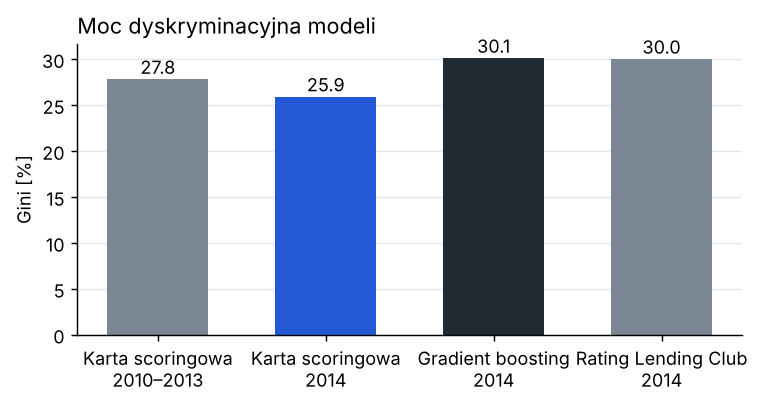
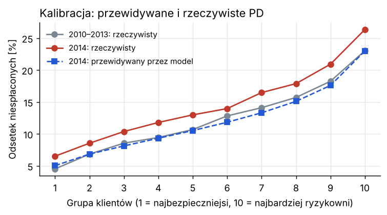

# Model ryzyka kredytowego (PD) dla kredytów konsumpcyjnych

Karta scoringowa przewidująca, czy klient spłaci kredyt, zbudowana tak jak w banku: grupowanie zmiennych (WoE), wybór zmiennych (IV), regresja logistyczna, punkty scoringowe i walidacja na danych z późniejszego roku. Dane: prawie 320 tys. rzeczywistych 36-miesięcznych kredytów z platformy Lending Club z lat 2010–2014.

## Wyniki

| | Próba modelowa (2010–2013) | Test na 2014 r. |
|---|---|---|
| Liczba kredytów | 166 459 | 153 204 |
| Odsetek niespłaconych | 12,4% | 14,6% |
| Gini karty scoringowej | 27,8% | 25,9% |
| KS | 0,20 | 0,19 |

- Model zachowuje moc na nowych danych: Gini spada tylko o 1,9 pkt proc., a rozkład punktów się nie zmienia (PSI = 0,004).
- Model zaniża ryzyko w 2014 r.: przewiduje średnio 12,1% niespłaconych, a było 14,6%. Różnica jest istotna w każdej grupie klientów, więc przed użyciem trzeba by go skalibrować na nowszych danych.
- Gradient boosting na tych samych danych osiąga Gini 30,1%, czyli tyle, co rating samej platformy (30,0%), który korzysta jeszcze z oceny z biura kredytowego (FICO).
- W ramach tego samego ratingu platformy, a więc przy podobnym oprocentowaniu, model wyraźnie rozdziela klientów. W kategorii C ryzykowniejsza połowa według modelu nie spłaciła 21,1% kredytów, a bezpieczniejsza 15,4%. Zwrot z pieniędzy wyniósł odpowiednio 7,2% i 9,8%.
- Najbardziej ryzykowne 10% klientów płaci najwyższe oprocentowanie (15,9%), a daje najniższy zwrot: 5,4%, podczas gdy w większości grup zwrot wynosi 8–9%. Ryzyko tych klientów jest za tanio wycenione.



Krótki raport z wynikami: [reports/Raport_model_ryzyka_kredytowego.pdf](reports/Raport_model_ryzyka_kredytowego.pdf).

## Dane

Dane Lending Club (amerykańska platforma pożyczek dla osób prywatnych) z repozytorium [kuhnrl30/LendingClubData](https://github.com/kuhnrl30/LendingClubData) (licencja MIT). Skrypt `src/download_data.py` pobiera kredyty z lat 2010–2014 i zapisuje potrzebne kolumny.

- Biorę tylko kredyty 36-miesięczne z ostatecznym statusem. Kredyty jeszcze spłacane pomijam.
- Klient „zły”: kredyt spisany na straty, w niewypłacalności albo z opóźnieniem powyżej 30 dni. Klient „dobry”: kredyt spłacony w całości.
- Zmienne to tylko informacje znane w dniu złożenia wniosku: dochód, zadłużenie, cel kredytu, historia kredytowa itd. Rating i oprocentowanie platformy służą wyłącznie do porównania.

## Jak powstał model

1. **Grupowanie zmiennych.** Każdą zmienną liczbową dzielę na przedziały (najpierw do 10 równych liczebnie, potem łączę sąsiednie, aż odsetek złych klientów rośnie albo maleje w jednym kierunku). Rzadkie kategorie łączę w „inne”.
2. **WoE i IV.** Dla każdego przedziału liczę WoE = ln(udział dobrych / udział złych), a dla zmiennej IV, czyli jej siłę. Do modelu biorę zmienne z IV ≥ 0,02. Z dwóch mocno skorelowanych zostawiam silniejszą.
3. **Regresja logistyczna** na wartościach WoE. Sprawdzam, czy wszystkie współczynniki mają ten sam znak, czyli czy wyższe WoE zawsze oznacza mniejsze ryzyko.
4. **Punkty.** 600 punktów to szansa 50:1, że klient spłaci, a każde 20 punktów więcej podwaja tę szansę. Tabela punktów: `reports/scorecard_points.csv`.

Do modelu weszło 7 z 18 zmiennych:



Zmienne o dawnych opóźnieniach, upadłościach czy wpisach w rejestrach prawie nic nie mówią. Lending Club odrzucał wnioski z poważnymi problemami, więc w danych zostali tylko klienci, których historia była dość czysta.

## Walidacja

Model buduję na kredytach z lat 2010–2013, a sprawdzam na kredytach z 2014 r., których nie widział (walidacja out-of-time).

- **Moc dyskryminacyjna:** Gini i KS, porównane z gradient boostingiem i z ratingiem platformy.
- **Kalibracja:** czy przewidywane PD zgadza się z rzeczywistym odsetkiem niespłaconych, w 10 grupach klientów, z testem dwumianowym.
- **Stabilność:** PSI rozkładu punktów i każdej zmiennej między próbą modelową a 2014 r. Najbardziej zmienił się cel kredytu (PSI = 0,07), ale wszystkie wartości są poniżej progu 0,1.





## Strata oczekiwana

Z niespłaconych kredytów z lat 2010–2013 liczę:
- EAD: w chwili niewypłacalności do spłaty zostaje średnio 58% pożyczonej kwoty,
- LGD: z tej kwoty nie udaje się odzyskać 89% (kredyty bez zabezpieczenia).

Strata oczekiwana na 2014 r. (PD × LGD × EAD) wynosi 113,5 mln USD, a rzeczywista strata 136,3 mln USD. Niedoszacowanie o 17% wynika z zaniżonego PD i jest kolejnym argumentem za ponowną kalibracją.

## Ograniczenia

- Dane zawierają tylko kredyty, które platforma udzieliła. Nie wiadomo, jak spłacaliby odrzuceni klienci, więc model może źle oceniać osoby spoza tej grupy (problem znany jako reject inference).
- Brak oceny z biura kredytowego (FICO), która w praktyce jest jedną z najsilniejszych zmiennych.
- Zwrot liczę jako sumę wpłat minus pożyczona kwota, bez uwzględnienia wartości pieniądza w czasie i kosztów obsługi.

## Uruchomienie

```bash
pip install -r requirements.txt
python3 src/download_data.py   # pobranie danych (ok. 60 MB)
python3 src/run.py             # model, walidacja, wykresy w reports/
python3 -m pytest              # testy
```

Pliki:
- `src/download_data.py` – pobranie danych
- `src/prepare.py` – definicja złego klienta i zmienne
- `src/scorecard.py` – grupowanie, WoE, IV, regresja logistyczna, punkty
- `src/validation.py` – Gini, KS, kalibracja, PSI
- `src/run.py` – uruchamia wszystko i rysuje wykresy
- `reports/summary.json` – wszystkie wyniki liczbowe
